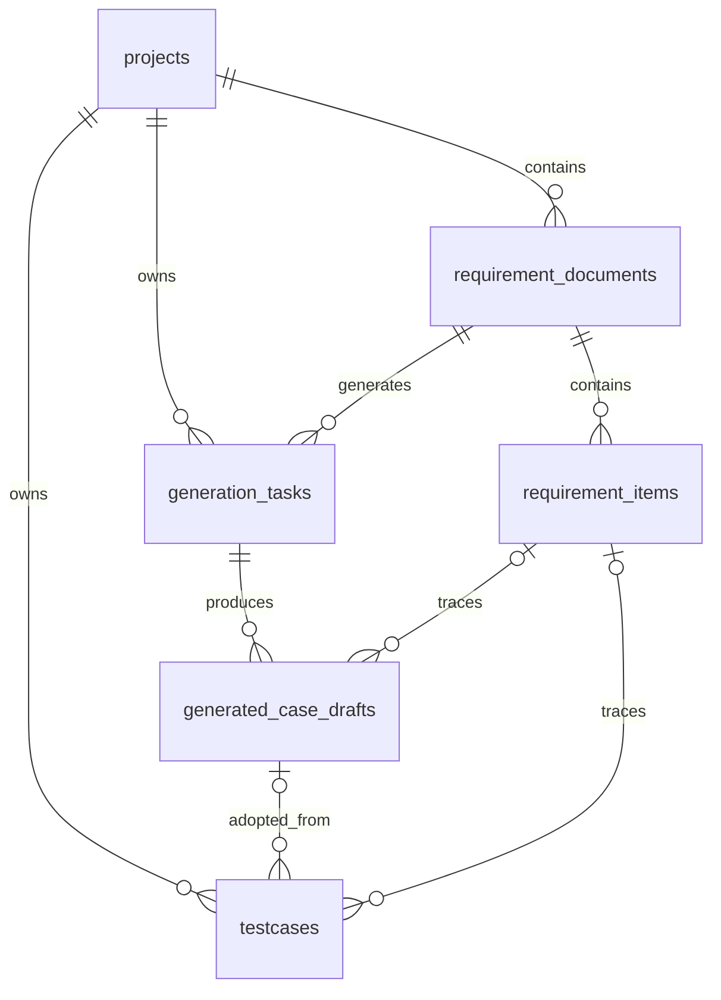

# 数据库结构与原项目对照

当前数据库覆盖四周目标中的核心流程：项目 → 需求文档 → 功能点 → 生成任务 → 用例草稿 → 正式用例。

- 实际加载的结构：`sql/schema.sql`，共 6 张业务表。
- 原项目完整结构参考：`sql/reference/original-schema.sql`，共 14 张表，不由当前初始化器加载。
- 参考来源：下载目录 `ai-testcase-studio/backend/app/models/*.py`。只提取结构，不复制数据库文件、业务数据、账户或密钥。

## 原项目的全部表

| 表名 | 原项目用途 | 当前核心版 |
| --- | --- | --- |
| `projects` | 项目及所属用户 | 保留，移除用户归属和评测专用字段 |
| `requirement_documents` | 需求原文、测试范围、处理状态 | 保留，移除评测专用字段 |
| `requirement_items` | 模块、功能点、验收标准、确认状态 | 保留 |
| `generation_tasks` | 生成策略、进度、错误、用量 | 保留，移除 RAG 引用和评测专用字段 |
| `generated_case_drafts` | AI 生成的草稿与人工评审记录 | 保留，移除规则质检和 AI Judge 字段 |
| `testcases` | 正式用例库与来源关联 | 保留 |
| `quality_reports` | 规则质检、覆盖率和 AI Judge 汇总 | 完整参考中保留 |
| `users` | 登录账户与密码哈希 | 完整参考中保留 |
| `system_config` | 每个用户的生成、评测、Embedding 配置 | 完整参考中保留 |
| `knowledge_documents` | RAG 知识文档 | 完整参考中保留 |
| `knowledge_chunks` | 文档分块及向量记录关联 | 完整参考中保留 |
| `eval_samples` | 离线评测样本及人工标准测试点 | 完整参考中保留 |
| `eval_runs` | 一次批量评测的状态及汇总指标 | 完整参考中保留 |
| `eval_results` | 单个评测样本在一次运行中的结果 | 完整参考中保留 |

## 六张核心表如何关联



一份需求可产生多个功能点，也可以多次生成。每次生成得到多条草稿；人工采纳时，将选定草稿的内容保存到 `testcases`，通过 `draft_id` 追溯来源。外键只维护关联，采纳和复制内容仍需业务接口实现。

## 核心版的明确调整

1. 当前按单用户学习项目实现，所以 `projects` 不包含 `user_id`，也不创建账户或初始密码。
2. JSON 文本使用可直接解析的初始值：`strategy_config` 为 `{}`，用例 `steps` 为 `[]`。`test_scope` 保留原项目的空字符串初始值，读取时需要处理空值。
3. 原模型不少默认值由 SQLAlchemy 的 Python `default=` 提供。当前使用直接 SQL，因此把需要的初始值写成 SQL `DEFAULT`，文本和布尔字段明确为非空。
4. 原项目不少删除级联由 ORM `relationship(cascade=...)` 执行。核心 SQL 明确声明数据库级 `ON DELETE CASCADE`，并在每个连接上开启 SQLite 外键检查。删除文档会同时删除其功能点和生成任务，删除任务会删除草稿；正式用例的失效来源引用设置为 `NULL`。删除项目则删除其下的需求、任务和正式用例。
5. 为关联字段增加索引；布尔字段限制为 `0` 或 `1`。SQLite 的 `VARCHAR(n)` 本身不强制字符串长度，后续接口仍需校验长度。
6. `created_at`、`updated_at` 创建时由数据库赋初值。更新内容时，业务代码需要同时更新 `updated_at`；没有自动更新时间触发器。原项目的 ORM `onupdate=` 同样不是数据库触发器。
7. `generation_tasks.strategy` 沿用原模型默认值 `detailed`。后续策略接口应明确支持的值，并与前端保持一致。

原项目完整参考文件由模型元数据编译，保留其数据库级约束与默认值。Python 层默认值、ORM 级联及初始化时的数据填充不包含在参考 DDL 中，所以它是结构参考，不是可直接替换原平台的迁移包。

## 初始化

在已激活的项目虚拟环境中运行：

```bash
python database.py
```

也可以照常启动 FastAPI，由现有 `lifespan` 调用 `init_db()`。

初始化器读取完整 SQL 脚本，通过 SQLite 驱动的 `executescript()` 执行，支持多条语句、注释以及字符串内的分号。事务由 Python 代码显式开启，成功后提交，失败后回滚；SQL 文件中不要额外写 `BEGIN`、`COMMIT` 或 `ROLLBACK`。

`CREATE TABLE IF NOT EXISTS` 和 `CREATE INDEX IF NOT EXISTS` 允许重复初始化并保留数据。它们不会修改已有表的字段；已有旧版三列表的数据库需要单独迁移，不能仅靠再次初始化升级结构。

数据库表结构准备好后，下一步仍是手写第一个业务闭环：`POST /projects` 创建项目，`GET /projects` 查询项目。
